<div align="center">

# 🐾 土豆宠物之家

**面向宠物门店的一体化运营系统**

Spring Cloud 微服务 · Vue 3 管理端 · uni-app 微信小程序 · Dify RAG Agent

</div>


## 一分钟了解

| 维度 | 内容 |
| --- | --- |
| 项目定位 | 宠物门店的“人、宠、货、单、问答”一体化运营系统 |
| 使用角色 | 门店管理员、普通客户 |
| 访问入口 | Web 管理端、Web 用户端、微信小程序 |
| 后端架构 | 1 个网关 + 4 个业务服务，Spring Boot 2.7 + Spring Cloud 2021 |
| 数据层 | MySQL 8 数据库、Redis 商品缓存、Nacos 服务注册 |
| AI 能力 | Dify Chatflow + 知识库检索 + DeepSeek 生成，Spring Boot 做 SSE 代理 |


## 界面预览

### Web 端

<p align="center">
  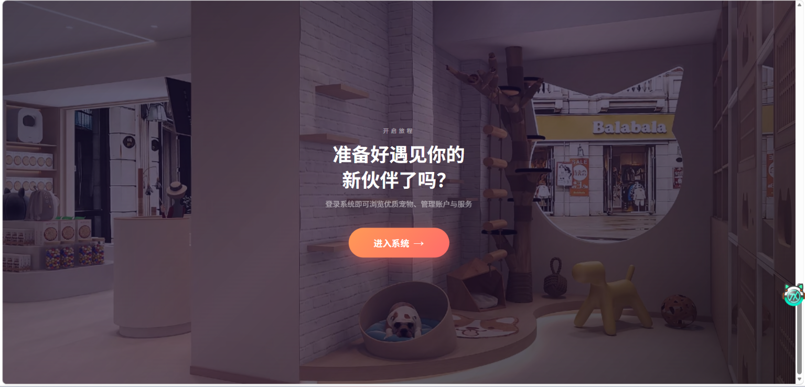
</p>
<p align="center"><em>品牌落地页：用沉浸式视觉介绍品牌故事、服务优势与系统入口。</em></p>

<p align="center">
  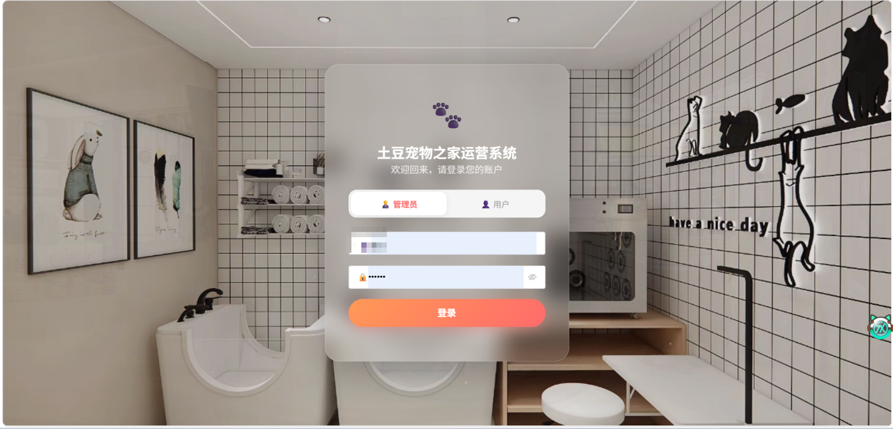
</p>
<p align="center"><em>登录页：管理员 / 用户双角色切换</em></p>

<p align="center">
  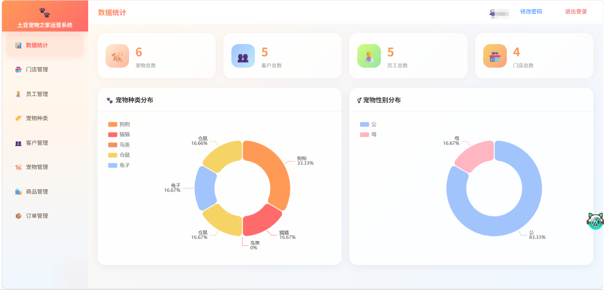
</p>
<p align="center"><em>管理端数据看板：门店、员工、客户、宠物数量概览，以及宠物种类/性别分布。</em></p>

<p align="center">
  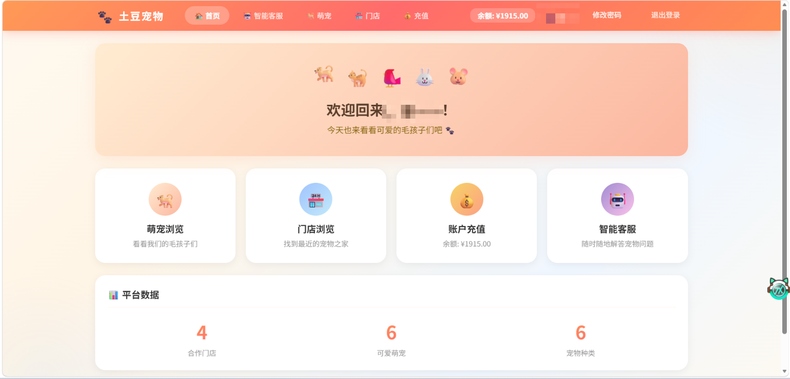
</p>
<p align="center"><em>用户端首页：萌宠浏览、门店浏览、账户充值、智能客服四个核心入口。</em></p>

### 微信小程序

<p align="center">
  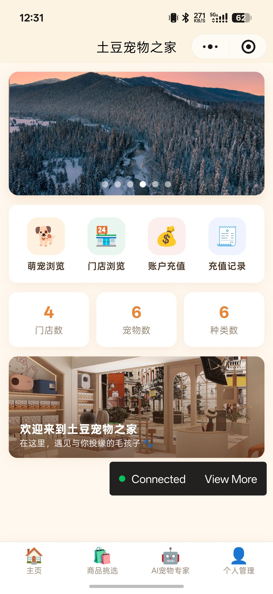
  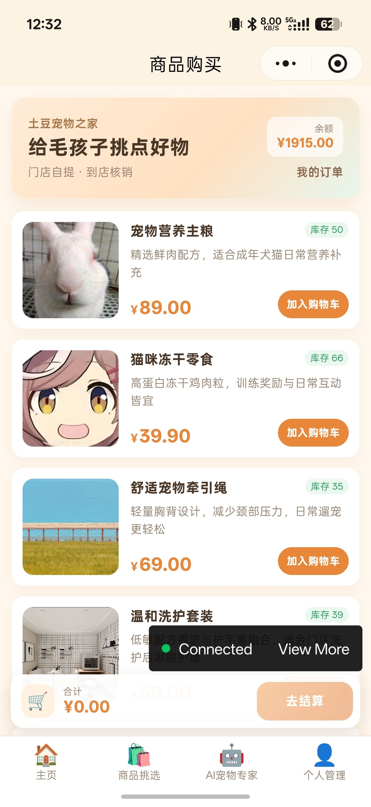
  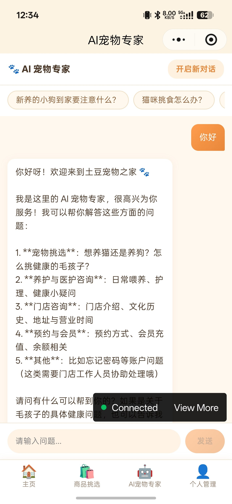
  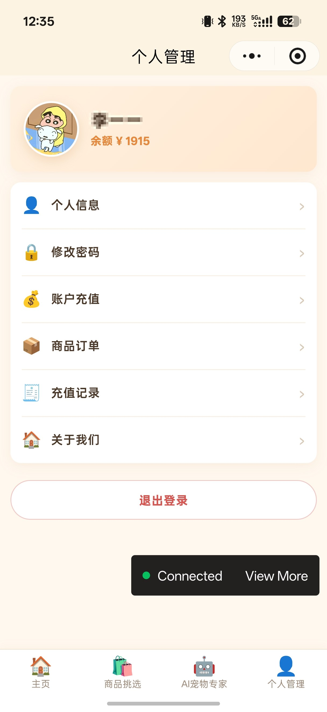
</p>
<p align="center"><em>小程序首页、商品购买、AI 宠物专家与个人中心。</em></p>

## 为什么做这个项目

宠物门店的日常运营通常被拆散在多个工具里：会员和余额在收银系统，宠物档案在表格里，商品库存在另一个软件，客户咨询靠人工回复。信息不一致、复购提醒缺失、服务体验割裂，是小门店最常见的痛点。

这个项目尝试把上述环节收拢到一套系统里：

- **一个账号体系**：管理员与客户统一登录，网关统一鉴权。
- **一份门店数据**：门店、员工、客户、宠物、商品、订单共用同一个业务库。
- **一条购买链路**：选商品 → 选门店 → 余额/模拟支付 → 生成核销码 → 到店核销。
- **一个 AI 入口**：把门店知识、服务价格、养护建议沉淀为 RAG 知识库，通过小程序/网页提供流式问答。

## 功能地图

| 端 | 模块 | 能力 |
| --- | --- | --- |
| Web 管理端 | 数据统计 | 宠物总数、客户总数、员工总数、门店总数；种类与性别分布图 |
| Web 管理端 | 门店管理 | 门店增删改查、图片上传、地址与联系电话维护 |
| Web 管理端 | 员工管理 | 员工档案、职位、所属门店、登录密码维护 |
| Web 管理端 | 宠物种类 | 种类增删改查、描述维护 |
| Web 管理端 | 客户管理 | 客户档案、联系方式、地址、余额维护 |
| Web 管理端 | 宠物管理 | 宠物档案、所属客户、种类、年龄、体重、头像 |
| Web 管理端 | 商品管理 | 商品上下架、价格、库存、图片、排序 |
| Web 管理端 | 订单管理 | 订单查询、核销码检索、到店核销 |
| Web 用户端 | 首页 | 余额、平台数据、快捷入口 |
| Web 用户端 | 萌宠/门店浏览 | 查看在售宠物与门店信息 |
| Web 用户端 | 账户充值 | 创建充值单、模拟微信/支付宝支付、充值记录 |
| Web 用户端 | 智能客服 | 基于知识库的流式 AI 问答 |
| 微信小程序 | 首页 | 轮播、快捷入口、平台数据 |
| 微信小程序 | 商品挑选 | 商品列表、购物车、选门店、余额/模拟支付、订单 |
| 微信小程序 | AI 宠物专家 | SSE 流式问答、会话续接、快捷问题 |
| 微信小程序 | 个人中心 | 资料、改密、充值、订单、充值记录、关于我们 |

## 系统架构

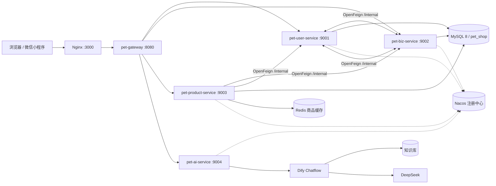

| 服务 | 端口 | 职责 |
| --- | --- | --- |
| `pet-gateway` | 8080 | JWT 校验、统一路由、CORS、请求日志 |
| `pet-user-service` | 9001 | 登录、改密、客户/员工、充值订单与模拟支付 |
| `pet-biz-service` | 9002 | 门店、宠物种类、宠物、统计、OSS 图片上传 |
| `pet-product-service` | 9003 | 商品、订单、库存、核销、Redis 商品缓存 |
| `pet-ai-service` | 9004 | Dify 阻塞问答与 SSE 流式问答 |
| `pet-common` | - | 统一响应、JWT、公共 DTO、安全头常量 |

更完整的服务边界、路由表与架构取舍见 [`docs/02-系统架构.md`](docs/02-系统架构.md)。

## 核心业务链路

### 1. 登录与网关鉴权

浏览器或小程序把账号密码提交到网关，转发给用户服务；登录成功后生成 JWT。后续请求在网关统一校验 JWT，并把用户名与角色写入内部请求头 `X-User-Name`、`X-User-Role`，业务服务不再重复解析登录状态。

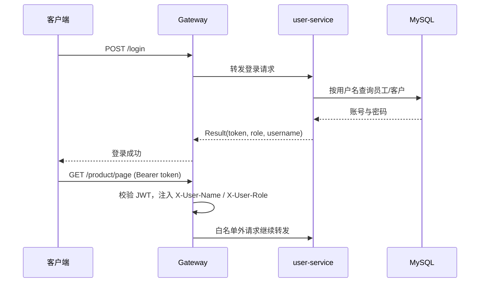

关键实现：`code/backend/pet-shop-cloud/pet-gateway/JwtAuthenticationFilter.java`、`code/backend/pet-shop-cloud/pet-common/JwtTokenProvider.java`。

### 2. 商品下单与到店核销

下单是项目里事务边界最集中的链路：校验门店、合并购物车、校验商品与库存、条件扣库存、余额支付、写订单与明细、清理商品缓存。

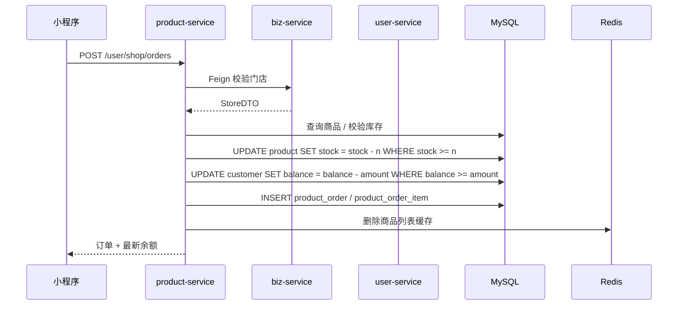

关键实现：`code/backend/pet-shop-cloud/pet-product-service/ProductOrderService.java`、`ProductOrderMapper.xml`、`CustomerBalanceMapper.xml`。

### 3. 账户充值与幂等支付

充值采用“先建单、后支付”的两阶段流程。支付时使用 `SELECT ... FOR UPDATE` 锁定订单，已成功的订单直接返回结果，避免重复回调导致余额重复入账。

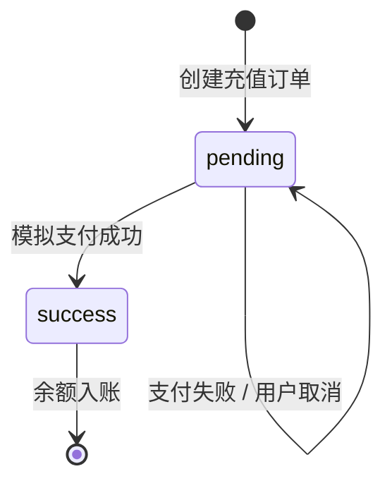

关键实现：`code/backend/pet-shop-cloud/pet-user-service/RechargeService.java`。

### 4. AI 宠物专家

AI 能力由 Dify 负责知识库检索与对话编排，Spring Boot 只做鉴权、参数校验与 SSE 转发；Dify / DeepSeek 的密钥只存在服务端，前端不接触。

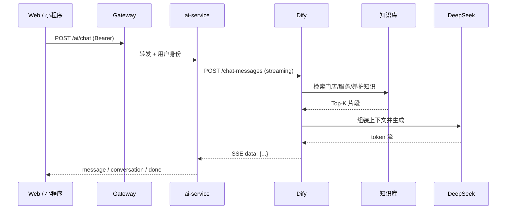

关键实现：`code/backend/pet-shop-cloud/pet-ai-service/DifyChatService.java`、`code/agent/prompts/system_prompt.md`、`code/agent/dify/chatflow_config.yml`。

更多业务细节见 [`docs/03-核心业务实现.md`](docs/03-核心业务实现.md)。

## 技术亮点

| 亮点 | 做法 | 价值 |
| --- | --- | --- |
| 网关统一鉴权 | JWT 校验、白名单、内部用户头注入 | 业务服务不重复处理登录态，入口统一 |
| 服务间内网调用 | OpenFeign + `/internal/**` 接口 | 跨服务补全门店名、客户名，避免前端多次请求 |
| 本地事务 + 条件更新 | 单库事务、`stock >= n`、`balance >= amount` | 在单库前提下保证扣减不超卖、不透支 |
| 缓存旁路 | Redis 商品列表缓存 + 增删改/下单后清理 | 降低高频商品查询压力，Redis 异常自动回源 |
| 幂等支付 | 订单行锁、状态判断、重复支付直接返回 | 模拟支付也不会重复加余额 |
| SSE 流式问答 | `SseEmitter` 转发 Dify 流、前端逐块渲染 | 降低首字等待，接近真实对话体验 |
| RAG 知识库 | 门店/服务/充值/养护/应急文档 + 系统提示词 | 回答有依据，降低编造门店电话与价格 |
| 多端复用 | Vue 3 Web + uni-app 小程序 + 统一 Result 协议 | 同一套后端服务支撑管理端与用户端 |

## AI Agent 设计

AI 宠物专家不是简单的“模型直答”，而是“知识库检索 + 提示词约束 + 流式输出”的组合：

1. **知识库**：门店信息、服务价格、会员充值、宠物养护、常见问答、紧急情况处理等 Markdown 文档。
2. **Chatflow**：开始节点 → 知识库检索 → LLM → 回答节点，`top_k`、阈值、模型均在 Dify 中配置。
3. **系统提示词**：明确“不得编造知识库外的电话/地址/价格”“紧急情况建议就医”“价格以门店确认为准”。
4. **服务端代理**：`/ai/chat` 只允许 `user` 角色访问，流式返回 `message`、`conversation`、`done` 三类事件。
5. **思考内容过滤**：后端过滤 `<think...>` 片段，避免推理过程直接展示给用户。
6. **小程序兼容**：优先 `enableChunked` 分块接收，不支持时自动降级到 `/ai/chat/blocking`。

详见 [`docs/05-AI-Agent与RAG.md`](docs/05-AI-Agent与RAG.md)。

## 代码精选与占比

本仓库保留能说明设计思路的关键代码，不提供完整可运行工程。

| 模块 | 展示文件数 | 展示行数 | 原模块源码行数 | 占比 |
| --- | ---: | ---: | ---: | ---: |
| 后端（Spring Cloud） | 30 | 2,061 | 4,218 | 48.9% |
| Web 前端（Vue 3） | 15 | 2,326 | 4,352 | 53.4% |
| 微信小程序（uni-app） | 9 | 2,013 | 4,163 | 48.4% |
| Agent 脚本/配置 | 2 | 189 | 315 | 60.0% |
| 数据库 DDL | 1 | 131 | — | —（仅 DDL；分母已含于原后端，不重复计入） |
| **合计** | **57** | **6,719** | **16,049** | **41.9%** |

> 统计口径：按 `.java`、`.vue`、`.js`、`.xml`、`.yml`、`.sql`、`.py`、`.json` 等源码/配置文件统计，排除 `node_modules`、`target`、`dist`、`package-lock` 与 Markdown 文档。Agent 知识库与说明文档另有 236 行，合计 6,955 行，占 43.3%。

完整文件清单与选段理由见 [`docs/08-代码索引与占比.md`](docs/08-代码索引与占比.md)。

## 安全与脱敏

本仓库在发布前做了系统性的脱敏处理，重点包括：

- **密钥**：Dify API Key、Dify Dataset Key、阿里云 OSS AccessKey ID/Secret、JWT Secret、数据库口令全部替换为环境变量占位符。
- **个人信息**：手机号、门店电话、客户地址、员工/客户姓名统一替换为演示值。
- **网络信息**：真机调试使用的局域网 IP、WSL 虚拟网卡地址替换为示例网段。
- **图片**：裁掉浏览器标签页、地址栏搜索词与 Windows 任务栏；对截图中的账号名称做像素化处理。
- **代码**：移除演示环境硬编码兜底管理员账号；数据库脚本只保留 DDL，删除全部 `INSERT` 演示数据。
- **不包含**：`.env`、真实 `application.yml`、OSS/Dify 配置、部署脚本、Nginx 配置、静态图片资源与完整源码。


## 仓库结构

```text
PotatoPetShop/
├── README.md                     # 项目展示主页
├── UPLOAD_GUIDE.md               # 手动上传 GitHub 指南
├── SECURITY.md                   # 安全说明与密钥轮换清单
├── NOTICE.md                     # 展示用途与版权说明
├── .gitignore
├── images/                       # 已脱敏的展示截图
├── docs/
│   ├── 01-项目全景.md
│   ├── 02-系统架构.md
│   ├── 03-核心业务实现.md
│   ├── 04-前端与小程序.md
│   ├── 05-AI-Agent与RAG.md
│   ├── 06-数据库设计.md
│   ├── 07-安全与脱敏.md
│   ├── 08-代码索引与占比.md
│   └── 09-本地运行与部署.md
└── code/                         # 代码节选
    ├── README.md
    ├── backend/
    ├── frontend/
    ├── miniapp/
    ├── agent/
    └── database/
```

## 本地运行

本仓库的 `code/` 是**节选代码**，缺少实体类、Mapper 接口、静态资源与完整配置，不能直接启动。

## 文档导航

| 文档 | 内容 |
| --- | --- |
| [`docs/01-项目全景.md`](docs/01-项目全景.md) | 背景、角色、场景、功能边界 |
| [`docs/02-系统架构.md`](docs/02-系统架构.md) | 服务拆分、网关、Feign、数据流、架构取舍 |
| [`docs/03-核心业务实现.md`](docs/03-核心业务实现.md) | 登录、充值、下单、核销、缓存 |
| [`docs/04-前端与小程序.md`](docs/04-前端与小程序.md) | 路由守卫、请求封装、SSE、跨端适配 |
| [`docs/05-AI-Agent与RAG.md`](docs/05-AI-Agent与RAG.md) | Dify Chatflow、知识库、提示词、评测 |
| [`docs/06-数据库设计.md`](docs/06-数据库设计.md) | 表结构、索引、事务与缓存一致性 |
| [`docs/07-安全与脱敏.md`](docs/07-安全与脱敏.md) | 脱敏矩阵、密钥轮换、生产加固 |
| [`docs/08-代码索引与占比.md`](docs/08-代码索引与占比.md) | 文件清单、行数、选段理由 |
| [`docs/09-本地运行与部署.md`](docs/09-本地运行与部署.md) | 环境变量、启动顺序、Nginx、小程序构建 |

## 免责声明

- 本项目为个人学习与设计展示，不构成商业产品，也不提供任何形式的线上服务承诺。
- 截图中的门店、客户、宠物、订单、余额均为演示数据；姓名与联系方式已脱敏。
- 代码节选仅用于技术交流，未授予开源许可证；未经本人授权，请勿将本项目整体或实质性部分用于商业用途。
- Dify、DeepSeek、阿里云 OSS、Spring、Vue、uni-app 等名称与商标归各自权利人所有。

---

<div align="center">

如果这个项目对你有帮助，欢迎点一个 ⭐ Star。

</div>

