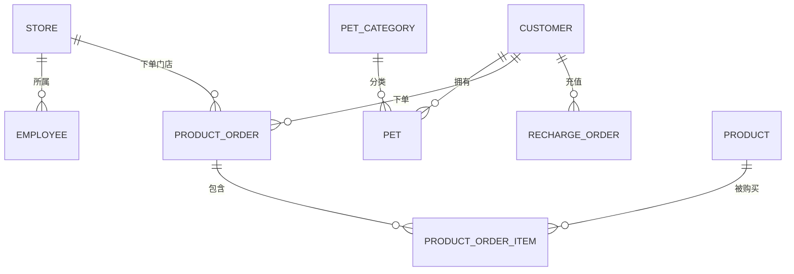

# 01 · 项目全景

## 1. 项目背景

宠物门店的运营通常包含三条并行的业务线：

1. **人**：员工、客户、会员余额、登录与权限。
2. **宠**：宠物档案、种类、所属客户、健康与养护信息。
3. **货与单**：商品、库存、下单、支付、到店核销。

传统做法往往把它们拆成收银软件、Excel、微信群和人工记忆。数据重复录入、余额对不上、库存超卖、客户咨询无人回复，是常见的运营问题。

“土豆宠物之家”尝试用一个统一的业务系统承接这三条线，并在此之上增加一个基于知识库的 AI 宠物专家，降低门店的重复咨询成本。

## 2. 目标与非目标

### 2.1 目标

- 管理员可以在一个后台维护门店、员工、客户、宠物、商品与订单。
- 客户可以在 Web 端或微信小程序查看宠物、门店、余额，完成充值与商品购买。
- 购买链路支持“选门店 → 选商品 → 余额/模拟支付 → 核销码 → 到店核销”。
- AI 宠物专家可以基于门店知识库回答服务、价格、地址、养护与应急问题。
- 后端服务可独立启动、独立注册、通过网关统一暴露接口。

### 2.2 非目标

- 不接真实微信支付/支付宝支付。
- 不做多租户、多品牌隔离。
- 不做跨库事务与消息队列。
- 不面向公网商用部署，默认运行在本机/局域网环境。

## 3. 角色与典型场景

| 角色 | 入口 | 典型场景 |
| --- | --- | --- |
| 门店管理员 | Web 管理端 | 新增门店、维护员工、查看统计数据、上架商品、核销订单 |
| 普通客户 | Web 用户端 | 查看萌宠与门店、充值余额、向 AI 提问 |
| 普通客户 | 微信小程序 | 浏览商品、加入购物车、选门店下单、查看订单、AI 问答 |
| AI 宠物专家 | 小程序/网页 | 回答门店地址、营业时间、服务价格、养护建议、紧急处理 |

### 3.1 管理员的典型一天

1. 登录管理端，查看首页统计：今日宠物、客户、员工、门店数量。
2. 在“商品管理”调整库存与上下架状态。
3. 在“订单管理”按订单号/核销码检索，客户到店后点击核销。
4. 在“客户管理”查看余额与联系方式，处理充值异常。
5. 在“宠物管理”补充宠物档案与所属客户。

### 3.2 客户的典型一天

1. 打开小程序首页，查看轮播、快捷入口与平台数据。
2. 进入“商品挑选”，把主粮、零食加入购物车。
3. 选择就近门店，使用余额或模拟支付完成下单。
4. 到店出示核销码，由店员核销。
5. 在“AI 宠物专家”询问“猫咪挑食怎么办”“新养的小狗到家要注意什么”。

## 4. 功能地图

### 4.1 Web 管理端

| 模块 | 关键能力 | 主要接口 |
| --- | --- | --- |
| 数据统计 | 宠物/客户/员工/门店总数，种类与性别分布 | `GET /dashboard/statistics` |
| 门店管理 | 门店 CRUD、图片、地址、电话 | `/store/**` |
| 员工管理 | 员工 CRUD、职位、所属门店、密码 | `/employee/**` |
| 宠物种类 | 种类 CRUD、描述 | `/category/**` |
| 客户管理 | 客户 CRUD、联系方式、地址、余额 | `/customer/**` |
| 宠物管理 | 宠物 CRUD、所属客户、种类、年龄、体重 | `/pet/**` |
| 商品管理 | 商品 CRUD、上下架、价格、库存、排序 | `/product/**` |
| 订单管理 | 订单分页、核销码检索、到店核销 | `/product-order/**` |
| 图片上传 | 上传图片到对象存储并返回 URL | `POST /upload/image` |

### 4.2 Web 用户端

| 模块 | 关键能力 | 主要接口 |
| --- | --- | --- |
| 首页 | 欢迎语、余额、快捷入口、平台数据 | `/user/info`、`/dashboard/statistics` |
| 萌宠浏览 | 查看在售宠物 | `/pet/page` |
| 门店浏览 | 查看门店列表与详情 | `/store/page`、`/user/shop/stores` |
| 账户充值 | 创建充值单、模拟支付、充值记录 | `/user/recharge/**` |
| 智能客服 | SSE 流式问答、会话续接 | `/ai/chat` |

### 4.3 微信小程序

| 页面 | 关键能力 |
| --- | --- |
| 首页 | 轮播、四个快捷入口、门店/宠物/种类统计 |
| 商品挑选 | 商品列表、购物车、选门店、支付、订单 |
| AI 宠物专家 | 流式问答、快捷问题、停止生成、新对话 |
| 个人中心 | 资料、改密、充值、订单、充值记录、关于我们 |

## 5. 业务对象与关系

核心对象：

- **Store**：门店名称、地址、电话、图片。
- **Employee**：员工姓名、性别、电话、职位、所属门店、登录密码。
- **Customer**：客户姓名、电话、地址、头像、密码、余额。
- **Pet**：宠物名称、种类、所属客户、年龄、性别、体重、头像、描述。
- **Product**：商品名称、描述、价格、库存、图片、上下架状态、排序。
- **ProductOrder / ProductOrderItem**：订单主表与商品快照明细。
- **RechargeOrder**：充值订单、支付渠道、状态、交易流水号。

## 6. 设计原则

1. **先跑通，再优化**：优先保证端到端链路可用，再引入 Redis、网关与 AI。
2. **单库优先**：在数据规模可控的前提下，用单库事务换取简单可靠。
3. **边界清晰**：网关只做入口治理，业务服务按领域拆分，内部接口不经过网关。
4. **失败可降级**：Redis 异常回源数据库；AI 流式不可用时小程序降级到阻塞接口。
5. **展示友好**：统一中文日志前缀，便于排障。
6. **安全默认值**：所有密钥走环境变量；演示数据与真实数据分离。

## 7. 项目规模

| 指标 | 数值 |
| --- | ---: |
| 后端服务 | 5 个（1 网关 + 4 业务） |
| 公共模块 | 1 个（`pet-common`） |
| 数据库表 | 9 张 |
| 原项目源码行数 | 16,049 行 |
| 本仓库代码节选 | 6,719 行（41.9%） |
| 展示文档 | 9 篇 + README  |

## 8. 阅读建议

- 第一次了解项目：先读根目录 `README.md`，看展示与功能地图。
- 关注后端设计：读 `02-系统架构.md` → `03-核心业务实现.md` → `06-数据库设计.md`。
- 关注前端与小程序：读 `04-前端与小程序.md`。
- 关注 AI：读 `05-AI-Agent与RAG.md`。

