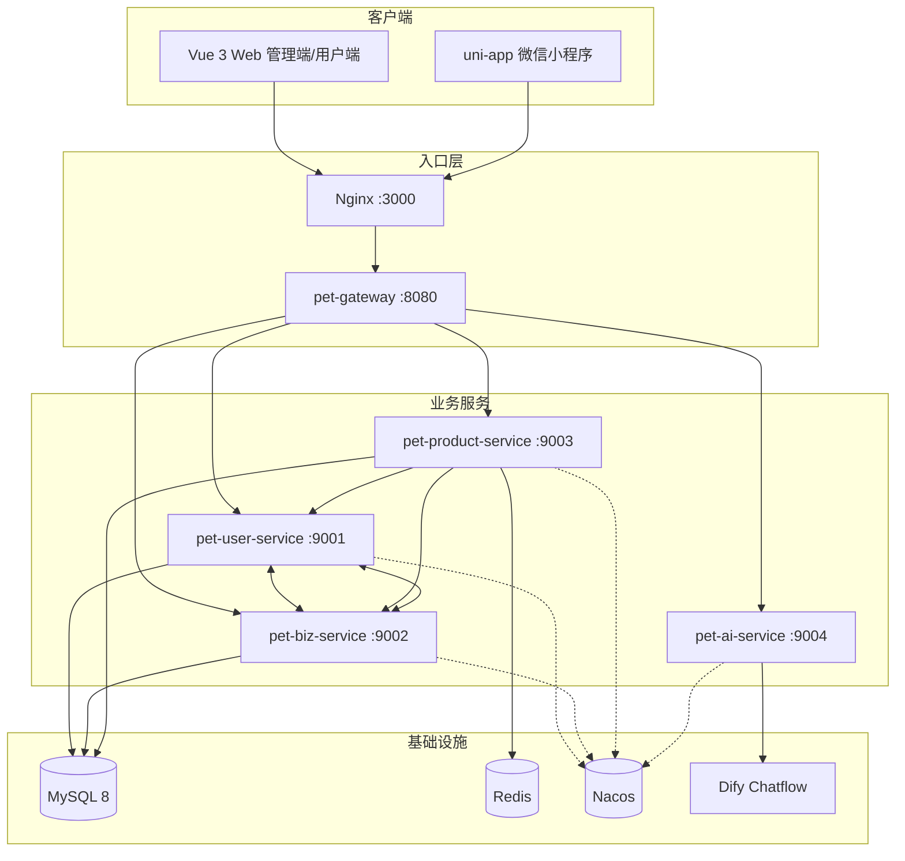

# 02 · 系统架构

## 1. 架构总览

系统采用“1 个网关 + 4 个业务服务 + 1 个公共模块”的轻量微服务结构：



## 2. 为什么是 1 + 4

项目并不是为了“微服务而微服务”，而是按业务边界做了最小拆分：

| 服务 | 拆分理由 |
| --- | --- |
| `pet-gateway` | 统一入口、统一鉴权、统一跨域与日志，避免每个服务重复实现 |
| `pet-user-service` | 账号、员工、客户、余额、充值都围绕“人”展开 |
| `pet-biz-service` | 门店、宠物、种类、统计、上传围绕“门店与宠物档案”展开 |
| `pet-product-service` | 商品、库存、订单、核销有独立的事务边界与缓存需求 |
| `pet-ai-service` | AI 调用有独立超时、流式协议与外部依赖，适合隔离 |

这样拆分的收益是：

- 登录与用户资料变更不会影响商品下单。
- 商品服务可以独立加缓存、独立扩容。
- AI 服务可以独立配置超时与 Dify 地址，不影响主业务。
- 网关可以统一处理鉴权、CORS 与请求日志。

代价是跨服务查询需要 Feign，且不能使用跨库 JOIN。项目通过“单库 + 内部批量接口”控制复杂度。

## 3. 服务职责

### 3.1 网关 `pet-gateway`

- 基于 Spring Cloud Gateway 的反应式网关。
- 路由：按路径前缀把请求转发到对应服务。
- 鉴权：校验 `Authorization: Bearer <token>`。
- 白名单：`/login`、`/error`、`/actuator/health`、`/actuator/info`。
- 用户头注入：校验通过后写入 `X-User-Name`、`X-User-Role`。
- CORS：统一配置允许的来源、方法、请求头。
- 日志：记录请求方法、路径、状态码、耗时。

### 3.2 用户服务 `pet-user-service`

- 登录、改密、当前用户信息。
- 员工与客户 CRUD。
- 充值订单创建、模拟支付、充值记录。
- 对外提供 `/internal/customers/**` 内部接口，供其他服务按 ID/用户名批量查询客户。

### 3.3 业务服务 `pet-biz-service`

- 门店、宠物种类、宠物 CRUD。
- 管理端统计：宠物种类分布、性别分布。
- OSS 图片上传。
- 对外提供 `/internal/stores/batch`，供商品服务校验门店。
- 通过 Feign 调用用户服务，为宠物列表补全客户姓名。

### 3.4 商品服务 `pet-product-service`

- 商品 CRUD、上下架、库存。
- 用户端商品列表（Redis 缓存）。
- 下单、余额/模拟支付、订单查询、到店核销。
- 通过 Feign 调用业务服务校验门店，调用用户服务解析当前客户。

### 3.5 AI 服务 `pet-ai-service`

- `/ai/chat`：SSE 流式问答。
- `/ai/chat/blocking`：阻塞问答，供小程序降级。
- 校验用户角色，只允许 `user` 角色访问。
- 过滤模型思考片段，转发 `message`、`conversation`、`done` 事件。

## 4. 请求链路

### 4.1 Web 端

```text
浏览器 :3000
  -> Nginx 静态资源 /api 反向代理
  -> Gateway :8080
  -> 目标业务服务
  -> MySQL / Redis
```

Nginx 负责两件事：

- 托管 Vue 构建后的静态文件。
- 把 `/api/**` 反向代理到网关，并对 `/api/ai/**` 关闭代理缓冲，保证 SSE 不被聚合。

### 4.2 小程序

```text
微信小程序
  -> http://<局域网 IP>:3000/api
  -> Nginx
  -> Gateway
  -> 业务服务
```

小程序开发阶段使用局域网 IP + HTTP；正式发布到微信时需要 HTTPS 域名并加入微信公众平台的 request 合法域名。

## 5. 网关设计

### 5.1 路由表

| 路由 ID | 目标服务 | 路径 |
| --- | --- | --- |
| `pet-user-service` | `lb://pet-user-service` | `/login`、`/change-password`、`/customer/**`、`/employee/**`、`/user/info`、`/user/profile/**`、`/user/recharge/**` |
| `pet-biz-service` | `lb://pet-biz-service` | `/store/**`、`/category/**`、`/pet/**`、`/dashboard/**`、`/upload/**`、`/user/shop/stores` |
| `pet-product-service` | `lb://pet-product-service` | `/product/**`、`/product-order/**`、`/user/shop/products/**`、`/user/shop/orders/**` |
| `pet-ai-service` | `lb://pet-ai-service` | `/ai/**` |

### 5.2 鉴权流程

1. 浏览器/小程序在请求头携带 `Authorization: Bearer <token>`。
2. 网关跳过 `OPTIONS` 预检请求与白名单路径。
3. 校验 token 签名、过期时间。
4. 从 token 中提取用户名与角色。
5. 移除客户端伪造的 `X-User-Name`/`X-User-Role`，写入可信值。
6. 转发到目标服务。

关键代码：`code/backend/pet-shop-cloud/pet-gateway/JwtAuthenticationFilter.java`。

### 5.3 为什么还要在服务里解析 token

部分用户端接口需要拿到当前客户 ID，而网关注入的是用户名与角色。业务服务通过 `BearerTokenResolver` 再次解析同一个 token，得到用户名，再调用用户服务查询客户详情。这样做的好处是：

- 网关负责“是否允许进入”。
- 业务服务负责“当前用户是谁、能操作哪些数据”。
- 不把完整用户对象塞进请求头，避免头过大与敏感信息扩散。

## 6. 服务间调用

| 调用方 | 被调方 | 接口 | 用途 |
| --- | --- | --- | --- |
| `pet-user-service` | `pet-biz-service` | `POST /internal/stores/batch` | 员工列表补全门店名 |
| `pet-biz-service` | `pet-user-service` | `POST /internal/customers/batch` | 宠物列表补全客户名 |
| `pet-product-service` | `pet-biz-service` | `POST /internal/stores/batch` | 下单校验门店并取门店名 |
| `pet-product-service` | `pet-user-service` | `GET /internal/customers/by-name/{name}` | 用户端解析当前客户 |

设计要点：

- 内部接口统一放在 `/internal/**`，不经过网关，避免外部直接访问。
- 使用 DTO（`StoreDTO`、`CustomerDTO`）而不是暴露实体，降低耦合。
- Feign 调用失败时记录日志并返回可控错误，不让空指针扩散。
- Feign 日志级别为 `full`，便于答辩展示完整请求/响应。

## 7. 数据层

### 7.1 单库设计

所有业务表都在 `pet_shop` 单库中：

- 允许同库 JOIN，订单查询可以直接关联客户与门店。
- 下单事务在商品服务内完成，包含扣库存、扣余额、写订单、写明细。
- 不引入 Seata、MQ、分布式事务。

这是有意的取舍：项目规模可控，单库事务比分布式事务更简单、更可靠，也更容易讲清楚。

### 7.2 Redis

商品服务使用 Redis 缓存“在售商品列表”：

- Key：`pet:shop:products:on-sale:v1`
- DB：6
- TTL：默认 600 秒
- 失效策略：商品增删改、下单成功后主动删除
- 降级：Redis 读写异常时记录日志并回源 MySQL

## 8. Nacos 与配置

- 每个服务启动时注册到 Nacos。
- 网关通过 `lb://服务名` 做服务发现与负载均衡。
- 配置项优先从环境变量读取，未配置时使用本地默认值。
- 真实密钥不写入仓库，展示配置只保留 `${ENV:placeholder}` 形式。

## 9. 可观测性

### 9.1 中文日志前缀

| 服务 | 前缀 | 示例 |
| --- | --- | --- |
| 网关 | `[GATEWAY]` | 收到请求、请求完成、状态码、耗时 |
| 用户服务 | `[USER]` | 登录成功/失败、充值、余额入账 |
| 业务服务 | `[BIZ]` | 门店/宠物查询、Feign 调用、OSS 上传 |
| 商品服务 | `[PRODUCT]` | 缓存命中、库存扣减、下单、核销 |
| AI 服务 | `[AI]` | Dify 调用、流式完成、耗时、会话 ID |

### 9.2 健康检查

每个服务暴露：

- `/actuator/health`
- `/actuator/info`

网关健康检查：`http://localhost:8080/actuator/health`。

## 10. 架构取舍

| 选择 | 收益 | 代价 | 适用前提 |
| --- | --- | --- | --- |
| 单库 | 事务简单、JOIN 方便 | 扩展性有限 | 数据量与并发可控 |
| 网关统一鉴权 | 入口一致、业务服务轻量 | 网关成为单点，需要高可用 | 单体部署/演示环境 |
| Feign 内部接口 | 服务边界清晰 | 多一次网络调用 | 内网、低延迟 |
| Redis 只缓存商品列表 | 收益明确、失效简单 | 缓存一致性需主动清理 | 商品读多写少 |
| AI 独立服务 | 隔离外部依赖与超时 | 多一个服务 | Dify 可能不稳定 |

## 11. 相关代码

- 网关鉴权：`code/backend/pet-shop-cloud/pet-gateway/JwtAuthenticationFilter.java`
- 网关日志：`code/backend/pet-shop-cloud/pet-gateway/RequestLogGlobalFilter.java`
- JWT：`code/backend/pet-shop-cloud/pet-common/JwtTokenProvider.java`
- 用户服务：`code/backend/pet-shop-cloud/pet-user-service/`
- 业务服务：`code/backend/pet-shop-cloud/pet-biz-service/`
- 商品服务：`code/backend/pet-shop-cloud/pet-product-service/`
- AI 服务：`code/backend/pet-shop-cloud/pet-ai-service/`
- 配置模板：各服务目录下的 `application.yml`（已脱敏）
