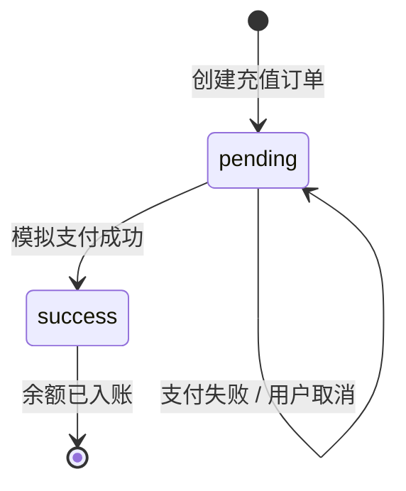
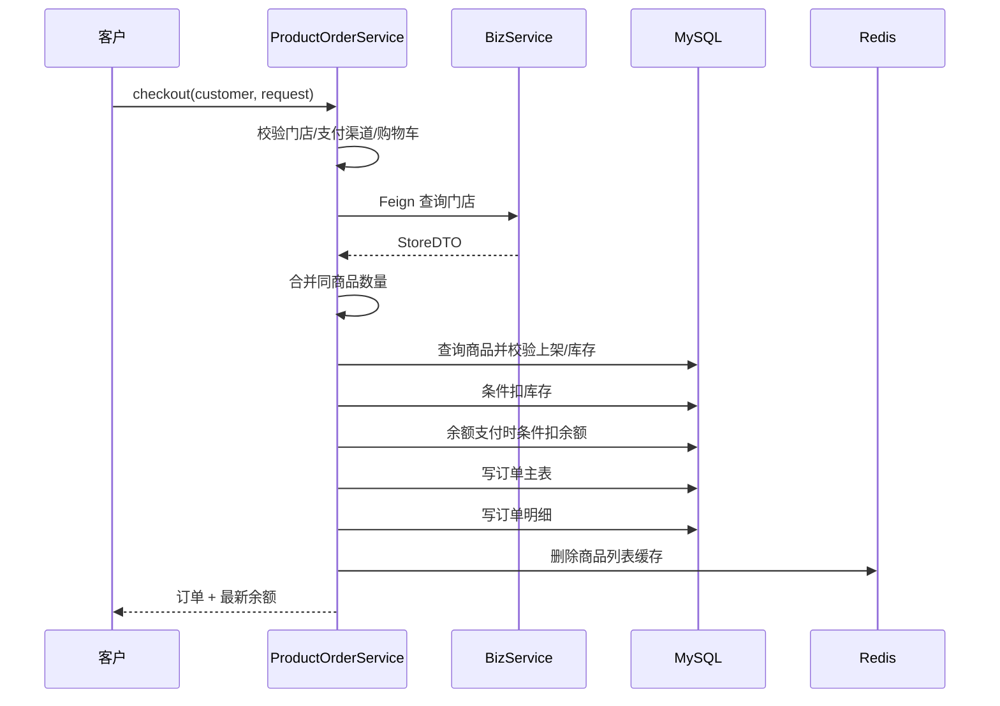

# 03 · 核心业务实现

这一篇挑出四条最能代表项目设计的链路：登录鉴权、账户充值、商品下单/核销、Redis 商品缓存。每条链路都对应本仓库中的脱敏代码。

## 1. 统一响应与分页

后端所有接口统一返回：

```java
public class Result<T> {
    private Integer code;
    private String message;
    private T data;
}
```

约定：

- `code = 200`：成功。
- `code = 401`：未登录/登录过期。
- `code = 400`：业务校验失败。
- `code = 404`：资源不存在。
- `code = 500/502`：服务端错误或上游不可用。

分页统一使用 PageHelper：

```java
PageHelper.startPage(pageNum, pageSize);
List<Product> products = productMapper.list(keyword, status);
return new PageInfo<>(products);
```

前端拿到 `PageInfo` 后直接绑定 `records`、`total`、`pages`，不需要每个页面重复写分页逻辑。

## 2. 登录与角色

### 2.1 登录流程

1. 前端提交 `username`、`password`、`role`。
2. 用户服务按 `role` 查询员工或客户。
3. 校验密码。
4. 生成 JWT，写入用户名与角色。
5. 返回 `token`、`username`、`role`，用户端额外返回 `userId`、`balance`。

```java
String token = jwtTokenProvider.generateToken(customer.getName(), "user");
Map<String, Object> data = new HashMap<>();
data.put("token", token);
data.put("username", customer.getName());
data.put("role", "user");
data.put("userId", customer.getId());
data.put("balance", customer.getBalance());
```

### 2.2 JWT

- 算法：HS256。
- 密钥长度校验：至少 32 字节。
- 过期时间：默认 24 小时，可通过环境变量调整。
- 载荷：`sub`（用户名）、`role`（admin/user）、签发时间、过期时间。

```java
return Jwts.builder()
        .setSubject(username)
        .claim("role", role)
        .setIssuedAt(now)
        .setExpiration(new Date(now.getTime() + expirationMillis))
        .signWith(key, SignatureAlgorithm.HS256)
        .compact();
```

### 2.3 网关注入用户头

网关校验通过后，先移除客户端可能伪造的头，再写入可信值：

```java
headers.remove(SecurityHeaders.USER_NAME);
headers.remove(SecurityHeaders.USER_ROLE);
headers.set(SecurityHeaders.USER_NAME, username);
if (role != null) {
    headers.set(SecurityHeaders.USER_ROLE, role);
}
```

### 2.4 当前实现的限制

演示代码使用明文密码比对：

```java
customer.getPassword().equals(request.getPassword())
```

这在真实项目中不可接受。生产环境应改为 BCrypt/Argon2 哈希，并做到：

- 数据库只存哈希，不存明文。
- 登录失败不区分“用户不存在/密码错误”，避免账号枚举。
- 增加登录失败次数限制与验证码。
- 强制首次登录修改初始密码。

展示代码已移除原演示环境的硬编码兜底管理员账号；生产环境不应存在任何内置账号。

## 3. 账户充值

### 3.1 状态机



### 3.2 创建订单

- 校验金额 > 0。
- 校验支付渠道：`wechat` / `alipay`。
- 生成订单号。
- 状态置为 `pending`，备注“模拟充值”。

### 3.3 支付与幂等

支付时先对订单行加锁：

```java
RechargeOrder order = rechargeOrderMapper.getByOrderNoForUpdate(orderNo);
```

然后按状态处理：

- 订单不存在：报错。
- 订单不属于当前客户：报错。
- 已是 `success`：直接返回支付结果，**不重复加余额**。
- 非 `pending`：状态异常。
- `pending`：更新为 `success` 并给客户加余额。

```java
if (STATUS_SUCCESS.equals(order.getStatus())) {
    return buildPayResult(order, customerId);
}
```

更新订单状态时使用带状态条件的 UPDATE：

```sql
UPDATE recharge_order
SET status = 'success', transaction_no = #{transactionNo}, pay_time = #{payTime}
WHERE order_no = #{orderNo} AND customer_id = #{customerId} AND status = 'pending'
```

如果影响行数为 0，再次查询订单；若已被其他请求置为成功，则返回成功结果，避免并发重复入账。

### 3.4 模拟支付

`mockPay` 中用 `Thread.sleep(1500 ~ 2500ms)` 模拟第三方支付耗时，并生成交易流水号。这是演示行为，不是真实支付。

## 4. 商品下单与核销

### 4.1 下单主流程



### 4.2 合并购物车

同一商品可能被重复添加，先按商品 ID 合并数量，并限制单件最多 99 件：

```java
quantities.merge(item.getProductId(), item.getQuantity(), Integer::sum);
if (quantities.get(item.getProductId()) > 99) {
    throw new RuntimeException("单件商品最多购买99件");
}
```

### 4.3 防超卖

库存扣减不是“先查再改”，而是带条件的原子 UPDATE：

```sql
UPDATE product
SET stock = stock - #{quantity}
WHERE id = #{id} AND stock >= #{quantity}
```

如果影响行数为 0，说明库存不足，抛出业务异常并回滚事务。

### 4.4 防透支

余额支付同样使用条件 UPDATE：

```sql
UPDATE customer
SET balance = balance - #{amount}
WHERE id = #{id} AND balance >= #{amount}
```

影响行数为 0 时提示“账户余额不足，请选择其他支付方式”。

### 4.5 事务边界

`checkout` 标注 `@Transactional`，以下操作在同一个本地事务中：

1. 扣库存。
2. 扣余额（余额支付时）。
3. 写订单主表。
4. 写订单明细。
5. 清理 Redis 缓存（在事务方法末尾）。

因为所有表都在同一个 `pet_shop` 库中，本地事务即可保证一致性，不需要 Seata。

### 4.6 订单号与核销码

- 订单号：`SP` + `yyyyMMddHHmmssSSS` + 3 位随机数。
- 核销码：6 位数字，使用 `SecureRandom` 生成，并检查唯一性，最多重试 30 次。
- 交易流水号：渠道大写 + UUID 前 20 位。

```java
String code = String.valueOf(100000 + SECURE_RANDOM.nextInt(900000));
if (productOrderMapper.countByVerificationCode(code) == 0) {
    return code;
}
```

### 4.7 核销

```sql
UPDATE product_order
SET status = 'completed', complete_time = NOW()
WHERE id = #{id} AND status = 'paid'
```

如果更新失败，再查订单状态；已是 `completed` 时视为幂等成功，避免店员重复点击报错。

## 5. Redis 商品缓存

### 5.1 缓存键

```text
pet:shop:products:on-sale:v1
```

- DB 6，避免与其它业务缓存混用。
- TTL 默认 600 秒。
- 只缓存“在售商品列表”，不缓存单个商品详情。

### 5.2 Cache-Aside

```java
Object cached = redisTemplate.opsForValue().get(PRODUCT_LIST_CACHE_KEY);
if (cached instanceof List) {
    return (List<Product>) cached;
}
List<Product> products = productMapper.listOnSale();
redisTemplate.opsForValue().set(key, products, ttl, TimeUnit.SECONDS);
return products;
```

### 5.3 失效

- 新增、修改、删除商品后主动删除缓存。
- 下单成功后删除缓存，避免库存展示滞后。
- Redis 异常时只记录日志，不影响数据库查询。

## 6. 错误处理

- 业务校验失败抛出 `RuntimeException`，由 Controller 捕获并转换为 `Result.error(400, message)`。
- 网关鉴权失败直接返回 401 JSON，不进入业务服务。
- AI 服务调用 Dify 失败返回 502，并提示“AI 服务暂时不可用”。
- Feign 调用失败记录 `[SERVICE] Feign ...` 日志，返回空结果或业务错误，避免 NPE。

## 7. 关键代码

| 链路 | 文件 |
| --- | --- |
| 登录/改密 | `code/backend/pet-shop-cloud/pet-user-service/LoginController.java` |
| JWT | `code/backend/pet-shop-cloud/pet-common/JwtTokenProvider.java` |
| 网关鉴权 | `code/backend/pet-shop-cloud/pet-gateway/JwtAuthenticationFilter.java` |
| 充值 | `code/backend/pet-shop-cloud/pet-user-service/RechargeService.java` |
| 下单 | `code/backend/pet-shop-cloud/pet-product-service/ProductOrderService.java` |
| 订单 SQL | `code/backend/pet-shop-cloud/pet-product-service/ProductOrderMapper.xml` |
| 余额 SQL | `code/backend/pet-shop-cloud/pet-product-service/CustomerBalanceMapper.xml` |
| 商品缓存 | `code/backend/pet-shop-cloud/pet-product-service/ProductService.java` |
| 用户端商品接口 | `code/backend/pet-shop-cloud/pet-product-service/UserShopController.java` |
