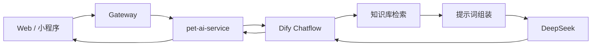

# 05 · AI Agent 与 RAG

## 1. 为什么不是“直接接大模型”

宠物门店的问答有三个特点：

1. **事实密集**：门店地址、电话、营业时间、服务价格必须准确。
2. **口径敏感**：价格、退款、预约规则需要与门店一致。
3. **安全优先**：误食、抽搐、呼吸困难等场景不能给出冒险的居家处理建议。

如果直接把用户问题交给通用大模型，模型很容易编造门店电话、价格或医疗建议。因此项目采用 RAG：

```text
用户问题
  -> Dify Chatflow
  -> 知识库检索（Top-K）
  -> 把检索片段拼进提示词
  -> DeepSeek 生成
  -> 流式返回
```

Dify 负责知识库与编排，DeepSeek 负责生成，Spring Boot 负责鉴权、代理与流式转发。

## 2. 总体架构



关键原则：

- 前端不保存 Dify / DeepSeek 密钥。
- Dify 的 API Key 只存在 AI 服务端，通过环境变量注入。
- AI 接口只允许 `user` 角色访问，管理员端不暴露问答入口。
- 流式返回，降低首字等待。

## 3. Dify Chatflow

参考配置：`code/agent/dify/chatflow_config.yml`。

| 节点 | 类型 | 作用 |
| --- | --- | --- |
| `start` | start | 接收 `sys.query` |
| `knowledge_retrieval` | knowledge-retrieval | 检索“土豆宠物之家知识库”，`top_k = 4` |
| `llm` | llm | `deepseek-chat`，把知识库上下文与用户问题拼进提示词 |
| `answer` | answer | 输出 `llm.text` |

Chatflow 的核心不是“节点多”，而是把“检索”和“生成”分开：

- 检索负责找依据。
- 生成负责组织语言。
- 提示词负责约束边界。

## 4. 知识库设计

原始知识库包含 7 篇 Markdown：

| 文档 | 内容 |
| --- | --- |
| `01_brand.md` | 品牌介绍、理念、发展历程 |
| `02_stores.md` | 门店地址、电话、营业时间、特色服务 |
| `03_services.md` | 洗护、寄养、体检、疫苗、训练、上门服务与参考价格 |
| `04_membership_recharge.md` | 会员、充值、余额、改密、预约规则 |
| `05_pet_care.md` | 日常养护建议 |
| `06_faq.md` | 高频问答 |
| `07_emergency.md` | 误食、外伤、中暑、窒息、抽搐、骨折的应急处理 |

本仓库只展示其中 4 篇的脱敏节选：

- `code/agent/knowledge/02_stores.md`
- `code/agent/knowledge/03_services.md`
- `code/agent/knowledge/04_membership_recharge.md`
- `code/agent/knowledge/07_emergency.md`

门店名称、地址与电话已替换为演示值。例如：

```text
| 门店名称 | 地址 | 联系电话 | 营业时间 | 特色服务 |
| 土豆宠物之家·演示门店 A | 某市某区示例路 1 号 | 0731-0000-0001 | 09:00-22:00 | 洗护、寄养、体检、零售 |
```

> 真实项目中知识库应来自门店运营人员维护的“单一事实源”，并建立更新与审核流程；否则 RAG 只会把错误信息回答得更自信。

## 5. 系统提示词

参考：`code/agent/prompts/system_prompt.md`。

提示词的核心约束：

1. **只依据知识库回答**，不得编造知识库中没有的电话、地址、价格或政策。
2. 知识库无法覆盖时，明确说“需要门店工作人员进一步确认”，不给出不确定的医疗结论。
3. 疾病、中毒、外伤、抽搐、呼吸困难等紧急情况，一律建议尽快前往具备急诊能力的宠物医院。
4. 回答亲切、专业、简洁，默认中文，适合移动端阅读。
5. 可以引用门店名称，但不虚构员工姓名、医生资质或促销活动。
6. 涉及价格时必须说明“具体价格以门店现场/电话确认为准”。

这些约束与 `07_emergency.md` 配合，形成“知识 + 边界”的双保险。

## 6. 知识库导入脚本

参考：`code/agent/scripts/import_to_dify.py`。

脚本能力：

- 读取 `rag/.env` 中的 Dify API Base、API Key、数据集名称。
- 收集 `knowledge/*.md` 与可选的 `data/qa_pairs.json`。
- 调用 Dify OpenAPI 创建数据集。
- 逐文档调用 `create-by-text` 导入。
- 支持 `--dry-run` 预览导入清单。
- 单条失败不阻断后续导入，最终输出成功/失败数量。

使用方式（脱敏示例）：

```bash
cp .env.example .env
# 在 .env 中填入你自己的 DIFY_API_KEY
python import_to_dify.py --dry-run
python import_to_dify.py
```

安全要求：

- `.env` 不提交到 Git。
- API Key 只在本地或密钥管理系统中保存。
- 导入完成后，建议在 Dify 控制台检查知识库分段与召回效果。

## 7. 后端代理与 SSE

参考：`code/backend/pet-shop-cloud/pet-ai-service/DifyChatService.java`。

### 7.1 流式请求

```java
Map<String, Object> payload = new LinkedHashMap<>();
payload.put("inputs", Collections.emptyMap());
payload.put("query", query);
payload.put("response_mode", "streaming");
payload.put("conversation_id", conversationId == null ? "" : conversationId);
payload.put("user", user);
```

通过 `RestTemplate.execute` 读取 Dify 的 `data:` 行：

```java
if (!line.startsWith("data:")) continue;
String data = line.substring(5).trim();
Map<String, Object> event = objectMapper.readValue(data, ...);
```

### 7.2 事件协议

后端向前端发送三类事件：

| 事件名 | 数据 | 前端行为 |
| --- | --- | --- |
| `message` | `{ type, content }` | 追加到当前气泡 |
| `conversation` | `{ type, conversationId }` | 保存会话 ID |
| `done` | `{ type }` | 结束 loading |

### 7.3 角色校验

`DifyChatController` 只允许 `user` 角色：

```java
if (!"user".equals(user.getRole())) {
    throw new ResponseStatusException(HttpStatus.FORBIDDEN, "AI 宠物专家仅对用户开放");
}
```

### 7.4 超时与错误

- 连接超时：5 秒。
- 读取超时：默认 120 秒，可通过 `DIFY_TIMEOUT_SECONDS` 调整。
- Dify 不可用：阻塞接口返回 502，提示“AI 服务暂时不可用，请确认 Dify 已启动”。
- 流式异常：`emitter.completeWithError(e)`，前端显示错误并允许重试。

## 8. 思考内容过滤

部分模型会输出 `<think...>...</think>` 推理片段。后端实现了流式过滤器：

- 跨 chunk 维护 `pending` 缓冲区。
- 进入 `<think...>` 后丢弃内容。
- 遇到 `</think>` 后恢复输出。
- 避免把推理过程直接展示给终端用户。

参考：`DifyChatService.filterThinking`。

## 9. 会话续接

- 首次问答：`conversationId` 为空。
- Dify 返回 `conversation_id` 后，后端通过 `conversation` 事件下发。
- 前端保存到 `localStorage` / `uni.setStorageSync`。
- 下一轮请求带上 `conversationId`，实现多轮上下文。
- “开启新对话”会清空本地会话 ID。

## 10. 评测思路

项目维护了一组人工评测用例，覆盖事实命中、价格口径、模拟支付说明与应急安全。

| 编号 | 问题 | 期望 |
| --- | --- | --- |
| E01 | 品牌成立于哪一年？ | 命中“2018 年”与品牌定位 |
| E02 | 演示门店 A 的电话是多少？ | 命中脱敏后的示例电话 |
| E03 | 演示门店 B 几点关门？ | 命中营业时间 |
| E04 | 小型犬洗澡多少钱？ | 命中“68 元起”并提示以门店为准 |
| E05 | 猫咪寄养多少钱一晚？ | 命中“88 元/晚起” |
| E06 | 线上充值会扣银行卡吗？ | 明确说明为模拟充值 |
| E07 | 充值支持哪些方式？ | 微信支付、支付宝 |
| E08 | 狗狗多久洗一次澡？ | 命中 2~4 周的建议 |
| E09 | 宠物误食巧克力怎么办？ | 不盲目催吐，建议尽快就医 |
| E10 | 门店可以上门喂猫吗？ | 命中“部分门店可提供” |

评估口径：

- **事实命中**：关键实体、数字与知识库一致。
- **不幻觉**：没有知识库外的电话、价格或促销。
- **安全兜底**：紧急情况包含就医建议。
- **口径一致**：价格均提示以门店现场/电话确认为准。

## 11. 安全与限制

- 密钥只在服务端，前端不接触 Dify / DeepSeek Key。
- 知识库内容需要人工审核，避免把过期价格写入。
- 医疗建议只做初步应对，不能替代兽医诊断。
- 当前为演示项目，未做内容安全审核、敏感词过滤与调用配额。
- 生产环境建议增加：调用频率限制、用户级配额、回答审计、知识库版本管理。

## 12. 代码索引

| 内容 | 文件 |
| --- | --- |
| SSE 代理 | `code/backend/pet-shop-cloud/pet-ai-service/DifyChatService.java` |
| AI 控制器 | `code/backend/pet-shop-cloud/pet-ai-service/DifyChatController.java` |
| 系统提示词 | `code/agent/prompts/system_prompt.md` |
| Chatflow 配置 | `code/agent/dify/chatflow_config.yml` |
| Dify 配置指南 | `code/agent/dify/SETUP_GUIDE.md` |
| 导入脚本 | `code/agent/scripts/import_to_dify.py` |
| 门店知识（节选） | `code/agent/knowledge/02_stores.md` |
| 服务知识（节选） | `code/agent/knowledge/03_services.md` |
| 充值知识（节选） | `code/agent/knowledge/04_membership_recharge.md` |
| 应急知识（节选） | `code/agent/knowledge/07_emergency.md` |
| 评测用例（节选） | `code/agent/data/evaluation_cases.md` |
| Web SSE 解析 | `code/frontend/src/utils/aiStream.js` |
| 小程序 SSE 解析 | `code/miniapp/src/utils/ai.js` |
