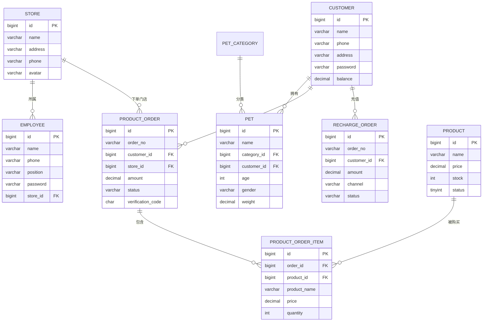

# 06 · 数据库设计

## 1. 设计原则

- **单库**：所有表在 `pet_shop` 库中，允许 JOIN。
- **快照**：订单明细保存商品名称、图片、成交价快照，避免商品改价影响历史订单。
- **条件更新**：库存与余额使用 `WHERE ... >= ...` 的原子扣减。
- **唯一约束**：订单号、核销码、充值订单号唯一。
- **脱敏**：本仓库只保留 DDL，删除全部 `INSERT` 演示数据。

## 2. ER 关系



## 3. 表清单

| 表 | 作用 | 关键字段 |
| --- | --- | --- |
| `store` | 门店 | `name`、`address`、`phone`、`avatar` |
| `employee` | 员工/管理员 | `name`、`phone`、`position`、`store_id`、`password` |
| `pet_category` | 宠物种类 | `name`、`description` |
| `customer` | 客户/会员 | `name`、`phone`、`address`、`balance`、`password` |
| `pet` | 宠物档案 | `name`、`category_id`、`customer_id`、`age`、`gender`、`weight` |
| `product` | 商品 | `name`、`price`、`stock`、`status`、`sort_order` |
| `product_order` | 商品订单 | `order_no`、`customer_id`、`store_id`、`amount`、`status`、`verification_code` |
| `product_order_item` | 订单明细 | `order_id`、`product_id`、`product_name`、`price`、`quantity`、`subtotal` |
| `recharge_order` | 充值订单 | `order_no`、`customer_id`、`amount`、`channel`、`status` |

## 4. 关键索引

| 表 | 索引 | 用途 |
| --- | --- | --- |
| `product` | `idx_product_status_sort(status, sort_order)` | 在售商品按排序展示 |
| `product_order` | `uk_product_order_no(order_no)` | 订单号唯一 |
| `product_order` | `uk_verification_code(verification_code)` | 核销码唯一 |
| `product_order` | `idx_product_order_customer(customer_id)` | 客户订单查询 |
| `product_order` | `idx_product_order_store(store_id)` | 门店订单查询 |
| `product_order` | `idx_product_order_status(status)` | 按状态筛选 |
| `product_order_item` | `idx_product_order_item_order(order_id)` | 订单明细查询 |
| `recharge_order` | `uk_order_no(order_no)` | 充值订单号唯一 |
| `recharge_order` | `idx_customer_id(customer_id)` | 客户充值记录 |
| `recharge_order` | `idx_status(status)` | 按状态筛选 |

## 5. 订单与库存一致性

### 5.1 库存扣减

```sql
UPDATE product
SET stock = stock - #{quantity}
WHERE id = #{id} AND stock >= #{quantity}
```

- 条件更新保证不会扣成负数。
- 影响行数为 0 时抛出“库存不足”，事务回滚。

### 5.2 余额扣减

```sql
UPDATE customer
SET balance = balance - #{amount}
WHERE id = #{id} AND balance >= #{amount}
```

- 条件更新保证不会透支。
- 余额支付失败时，库存扣减随事务回滚。

### 5.3 订单快照

`product_order_item` 保存：

- `product_name`：下单时的商品名。
- `product_image`：下单时的图片。
- `price`：成交单价。
- `quantity`、`subtotal`。

即使商品后续改名、改价、下架，历史订单仍然可读。

## 6. 状态字段

### 6.1 商品状态

| 值 | 含义 |
| --- | --- |
| `1` | 上架 |
| `0` | 下架 |

### 6.2 商品订单状态

| 值 | 含义 |
| --- | --- |
| `paid` | 已支付，待核销 |
| `completed` | 已核销 |

### 6.3 充值订单状态

| 值 | 含义 |
| --- | --- |
| `pending` | 待支付 |
| `success` | 支付成功，余额已入账 |

## 7. Redis 与数据库

| 项目 | 内容 |
| --- | --- |
| 缓存键 | `pet:shop:products:on-sale:v1` |
| 缓存内容 | 在售商品列表 |
| TTL | 默认 600 秒 |
| 更新策略 | 商品增删改、下单成功后删除 |
| 降级 | Redis 异常回源 MySQL |

缓存只承担“读多写少”的商品列表，不缓存订单、余额等强一致数据。

## 8. DDL 节选

完整 DDL 见 `code/database/schema.sql`。

```sql
CREATE TABLE `product_order` (
  `id` BIGINT NOT NULL AUTO_INCREMENT COMMENT '订单ID',
  `order_no` VARCHAR(64) NOT NULL COMMENT '订单号',
  `customer_id` BIGINT NOT NULL COMMENT '客户ID',
  `store_id` BIGINT NOT NULL COMMENT '下单门店ID',
  `amount` DECIMAL(10,2) NOT NULL DEFAULT 0.00 COMMENT '订单金额',
  `payment_channel` VARCHAR(20) NOT NULL COMMENT '支付渠道: balance/wechat/alipay',
  `status` VARCHAR(20) NOT NULL DEFAULT 'paid' COMMENT '状态: paid/completed',
  `verification_code` CHAR(6) NOT NULL COMMENT '6位核销码',
  `transaction_no` VARCHAR(64) DEFAULT NULL COMMENT '交易流水号',
  `create_time` DATETIME DEFAULT CURRENT_TIMESTAMP,
  `pay_time` DATETIME DEFAULT NULL,
  `complete_time` DATETIME DEFAULT NULL,
  PRIMARY KEY (`id`),
  UNIQUE KEY `uk_product_order_no` (`order_no`),
  UNIQUE KEY `uk_verification_code` (`verification_code`)
) ENGINE=InnoDB DEFAULT CHARSET=utf8mb4 COMMENT='商品订单表';
```

## 9. 数据隐私

本仓库的数据库脚本：

- 只保留 `CREATE TABLE` 与索引。
- 删除全部 `INSERT` 演示数据。
- 删除客户手机号、地址、员工电话等示例记录。
- 将密码默认值改为 `NULL`，避免出现默认弱口令。

真实部署时应：

- 使用强密码与独立数据库账号。
- 密码字段存储哈希值。
- 对手机号、地址等字段做加密或脱敏展示。
- 定期备份并限制备份文件访问权限。
